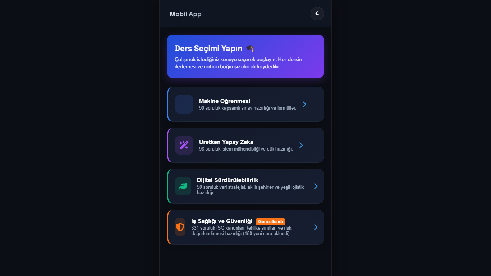
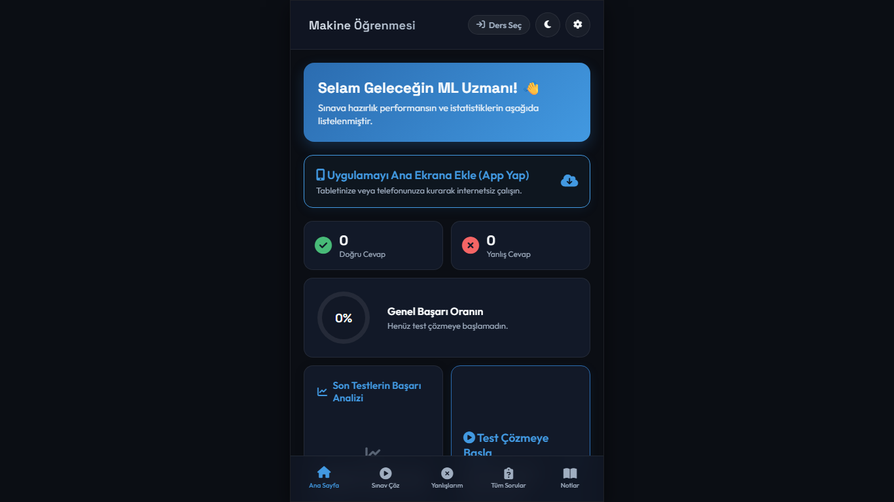
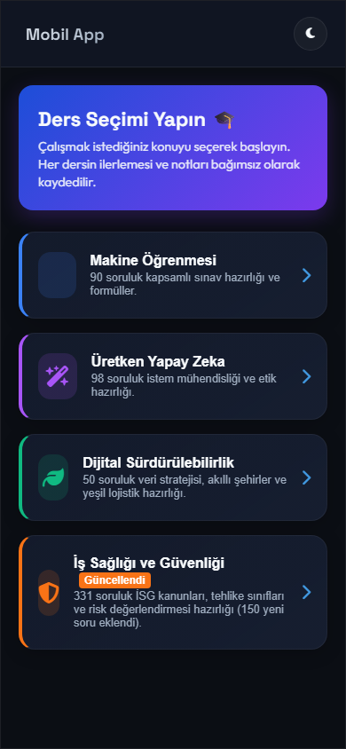

# 🎓 Akademik Sınav Hazırlık & İnteraktif Soru Çözüm Platformu (PWA)

[](https://github.com/oguztasdemir/Akademik-Sinav-Hazirlik-Platformu/actions/workflows/ci.yml)


Bu proje; üniversite dönem sonu **İş Sağlığı ve Güvenliği (İSG)**, **Makine Öğrenmesi (ML)**, **Üretken Yapay Zeka (Generative AI - GAI)** ve **Dijital Sürdürülebilirlik (DS)** final sınavlarına çalışma, konu kavrama ve soru tekrarı amacıyla geliştirilmiş **Progressive Web App (PWA)** destekli yerel soru çözüm platformudur.

---

## 🚀 Öne Çıkan Özellikler

* 📱 **PWA & Dinamik QR Kod Entegrasyonu:** main.py çalıştırıldığında terminalde otomatik yerel IP ve QR kod üretir. Telefondan QR kod taranarak aynı ağ üzerinden uygulama mobil tarayıcıda açılabilir veya ana ekrana eklenerek (PWA) tam ekran uygulama gibi kullanılabilir.
* 📚 **4 Temel Final Dersi Modülü:**
  * 🛡️ **İSG (İş Sağlığı ve Güvenliği):** Mevzuat, iş güvenliği kuralları ve risk değerlendirme soru setleri.
  * 🤖 **ML (Machine Learning):** Denetimli/denetimsiz öğrenme, regresyon, sınıflandırma ve model metrikleri.
  * 🎨 **GAI (Generative AI):** LLM mimarileri, prompt mühendisliği, difüzyon modelleri ve üretken yapay zeka kavramları.
  * 🌿 **DS (Dijital Sürdürülebilirlik):** Yeşil bilişim, dijital dönüşümün çevresel etkileri, sürdürülebilir teknoloji ve enerji verimliliği soruları.
* ⚡ **İnteraktif Çözüm & Anlık Geribildirim:** Konu testleri, karışık deneme sınavları, yanlış yapılan soruların analizi ve doğru/yanlış anlık çözüm açıklamaları.
* 📶 **%100 Çevrimdışı (Offline) Desteği:** Service Worker (sw.js) ve yerel statik mimari sayesinde internet bağlantısı olmadan da kesintisiz çalışır.

---

## 🛠️ Teknik Altyapı & Mimari

* **Arka Yüz (Yerel Sunucu):** Python http.server, socket, qrcode (Otomatik LAN IP çözümleme ve QR kod konsol render motoru).
* **Ön Yüz (PWA İstemcisi):** Vanilla JavaScript (ES6+), Modern CSS3 (Responsive Design), HTML5 Semantic.
* **Depolama & Önbellek:** Service Worker Cache API & LocalStorage.

---

## 💻 Kurulum ve Çalıştırma

1. **Gereksinimler:** Python 3.8+
2. **Uygulamayı Başlatma:**
`ash
python main.py
`
3. **Kullanım:**
   * Bilgisayardan: http://localhost:8000
   * Telefondan: Terminalde beliren QR kodu telefon kamerasıyla okutarak veya gösterilen yerel IP adresine giderek bağlanabilirsiniz.

---

## 👤 Geliştirici
* **Oğuz Taşdemir** — [GitHub](https://github.com/oguztasdemir) • [LinkedIn](https://www.linkedin.com/in/oguz-tasdemir-846889353/)


---

## Ekran Görüntüleri

### Akademik Sinav Merkezi Ders Secimi


### Ders Dashboard Ve Istatistikler


### Mobil Pwa Soru Cozum Arayuzu



---

## Yerel Testler

Projenin temel çalışma ve sözdizimi doğrulama testlerini çalıştırmak için:

```bash
pip install pytest
pytest tests -v
```
